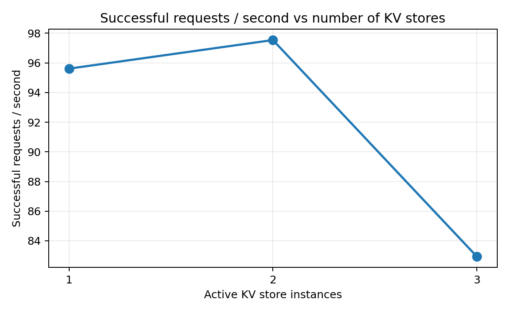
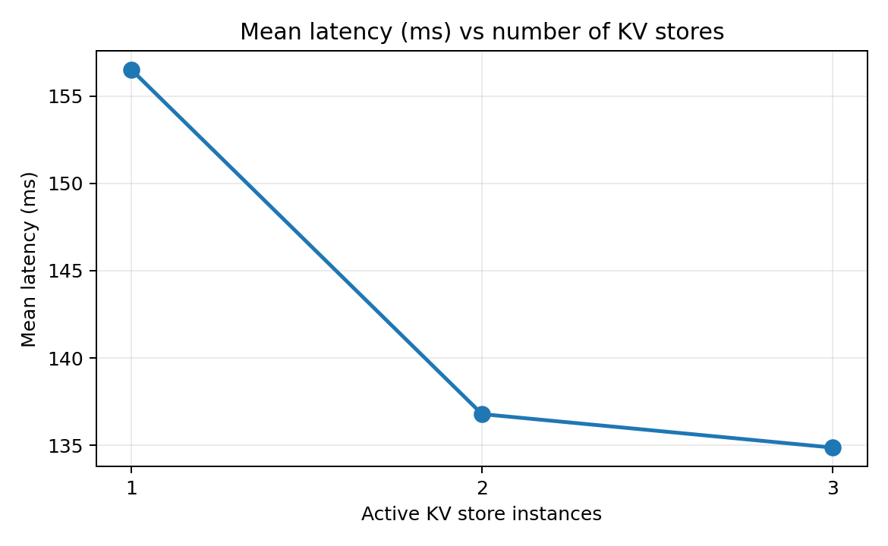
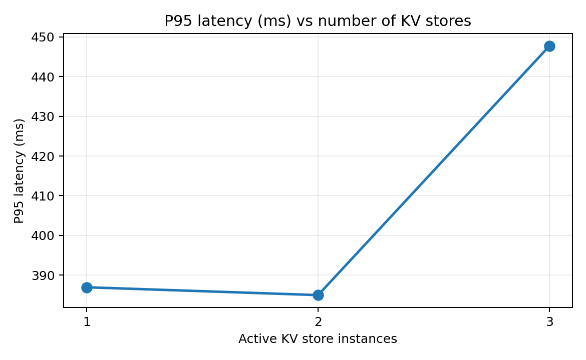

# Distributed Key-Value Store with Consistent Hashing

A Dockerized Flask and SQLite key-value store extended with a consistent-hashing router and up to three independently persisted storage nodes. The implementation supports basic CRUD requests, explicit membership changes, key redistribution, and concurrent forwarding through a single router.

## Architecture

```text
Client / benchmark
       |
       v
Flask router :8000
       |
SHA-256 consistent-hash ring (128 virtual nodes per store)
       |
  +----+----+
  |    |    |
 kv1  kv2  kv3  (Flask :8080 inside Docker)
  |    |    |
SQLite databases in separate Docker volumes
```

The router is the only published service in the Compose deployment. All three backend containers run on the private Docker network; membership determines which stores receive traffic. Data is **partitioned, not replicated**. The reader/writer lock allows concurrent ordinary requests and reserves exclusive access for synchronous membership migrations.

## Repository contents

| File | Description |
|---|---|
| `server.py`, `Dockerfile` | Flask/SQLite backend and backend image |
| `router.py`, `Dockerfile.router` | HTTP gateway, membership management, concurrency coordination |
| `hash_ring.py` | SHA-256 consistent hashing with 128 virtual nodes per store |
| `compose.yaml` | Router, three backends, private network, persistent volumes |
| `benchmark_hw3.py`, `plot_hw3.py` | End-to-end benchmark and performance plots |
| `test_hash_ring.py`, `test_integration_hw3.py` | Hash-ring and distributed integration tests |
| `test_router_lock.py`, `test_concurrency.py` | Reader/writer lock tests and concurrent HTTP operations |
| `README_HW3.md`, `REPORT_HW3.md` | HW3 instructions and experimental report |
| `HW3_Complete_PowerShell_History.txt` | Recorded commands and outputs |
| `results/benchmark.csv`, `results/*.png` | Measured results and figures |

The original standalone scripts (`demo.py`, `test_server.py`, `kv_bench.py`, and `kv_bench_instructor.py`) are retained for the single-server implementation. The standalone backend uses port 8080; the distributed router uses port **8000**. Do not confuse these endpoints.

## Requirements and setup

Docker Desktop with Linux containers and Docker Compose, plus Python 3.11 for local testing. The recorded environment used Windows PowerShell 5.1, Python 3.11.9, Docker 29.9.2, Docker Compose 5.6.1, and a Docker engine reporting 4 CPUs and 4,037,599,232 bytes of memory.

```powershell
docker compose up -d --build
docker compose ps
Invoke-RestMethod -Uri "http://localhost:8000/health" -TimeoutSec 300 | ConvertTo-Json -Depth 10
python -m pip install -r requirements-dev.txt
```

## API examples (PowerShell)

```powershell
Invoke-RestMethod -Uri "http://localhost:8000/example" -Method Put -ContentType "application/json" -Body '{"value":"hello"}' -TimeoutSec 300
Invoke-RestMethod -Uri "http://localhost:8000/example" -Method Get -TimeoutSec 300
Invoke-RestMethod -Uri "http://localhost:8000/example" -Method Put -ContentType "application/json" -Body '{"value":"updated"}' -TimeoutSec 300
Invoke-RestMethod -Uri "http://localhost:8000/example" -Method Delete -TimeoutSec 300
```

GET on a deleted key returns HTTP 404. Membership and distribution endpoints require the `X-Admin-Token` header; the example `local-dev-token` is for local development only.

```powershell
Invoke-RestMethod -Uri "http://localhost:8000/_admin/membership" -Method Post -ContentType "application/json" -Headers @{"X-Admin-Token"="local-dev-token"} -Body '{"nodes":["kv1","kv2","kv3"]}' -TimeoutSec 300
Invoke-RestMethod -Uri "http://localhost:8000/_admin/distribution" -Headers @{"X-Admin-Token"="local-dev-token"} -TimeoutSec 300
```

## Tests

```powershell
python -m pytest -q test_hash_ring.py
python -m pytest -q test_integration_hw3.py
python -m pytest -v -s test_router_lock.py test_concurrency.py
```

Recorded outcomes:

| Check | Result |
|---|---|
| Hash ring unit tests | 3 passed in 0.14 s |
| Integration test | 1 passed in 598.50 s |
| Router locking and concurrency tests | 2 passed in 4.74 s |
| Concurrent request exercise | 60 PUTs and 30 DELETEs on one key completed successfully |

The first concurrency test attempt failed during collection because the client targeted port 8080 rather than the router's port 8000. After correcting the endpoint and rerunning, both tests passed. The integration test took nearly ten minutes in total; a 300-second timeout applies to each HTTP request, not the entire test process.

## Performance results

```powershell
python benchmark_hw3.py --operations 1200 --workers 16 --repeats 3
python plot_hw3.py
```

The benchmark uses 80% GET and 20% PUT by default, 128-byte values, 16 workers, and three repeats per configuration. It seeds keys before timing and removes them afterward. The measurements therefore describe timed requests through the router, excluding seeding, cleanup, and membership migration. The summary is the arithmetic average of three run-level metrics; the P95 column is an average of run-level P95 values, not a pooled percentile.

| Active stores | Throughput (ops/s) | Mean latency (ms) | Mean P95 latency (ms) | Successful / attempted | Errors |
|---|---:|---:|---:|---:|---:|
| 1 | 101.65 | 156.50 | 436.77 | 3,600 / 3,600 | 0 |
| 2 | 116.06 | 136.78 | 276.66 | 3,600 / 3,600 | 0 |
| 3 | 117.84 | 134.87 | 266.51 | 3,600 / 3,600 | 0 |


Relative to one active store, three stores increased mean throughput by **15.9%**, reduced mean latency by **13.8%**, and reduced the average run-level P95 latency by **39.0%**. All 10,800 timed operations succeeded. The increase from two to three stores was modest, so these results support positive but sublinear scaling under this workload.







## Key distribution and migration

| Active stores | kv1 | kv2 | kv3 | Total |
|---|---:|---:|---:|---:|
| 3 | 986 | 962 | 1,052 | 3,000 |
| 2 | 1,527 | 1,473 | — | 3,000 |
| 1 | 3,000 | — | — | 3,000 |
| 3 (restored) | 986 | 962 | 1,052 | 3,000 |

All 3,000 distinct keys were inserted and retrieved with their expected values before reconfiguration (3,000 correct, zero errors). The five sampled keys (1, 500, 1,000, 2,000, and 3,000) were also retrieved successfully after each scale-down and after restoring three stores. Physical counts stayed at 3,000 throughout the recorded membership transitions; a complete 3,000-key readback was not recorded after every transition.

The membership API reported 1,052 copied keys for 3→2, 1,473 for 2→1, and 2,014 for 1→3. These are the router's `moved` values, not independently timed migration-throughput measurements.

## Operational notes and limitations

- The router forwards ordinary requests concurrently but blocks them during membership migration. Migration is synchronous and can be slow when many keys are present.
- Upstream HTTP requests use 300-second timeouts. This does not impose a five-minute limit on a whole test or migration, which may issue many requests.
- SQLite connections and writes, a single router, and shared host resources constrain throughput.
- There is no replication, automatic failover, consensus, or multiple-router membership synchronization.
- Use `docker compose down` to stop the deployment without deleting volumes; avoid `docker compose down -v` if data must be preserved.
- The latest benchmark CSV and figures correspond to the concurrent-router implementation; older benchmark data is preserved under `results/historical_backup/`.

For the full experiment and per-run measurements, see [REPORT_HW3.md](REPORT_HW3.md). For the complete recorded command sequence, see [HW3_Complete_PowerShell_History.txt](HW3_Complete_PowerShell_History.txt).
