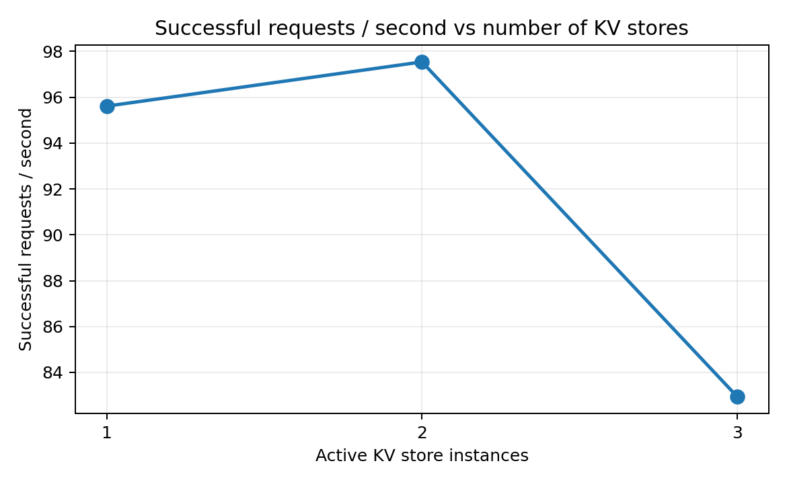
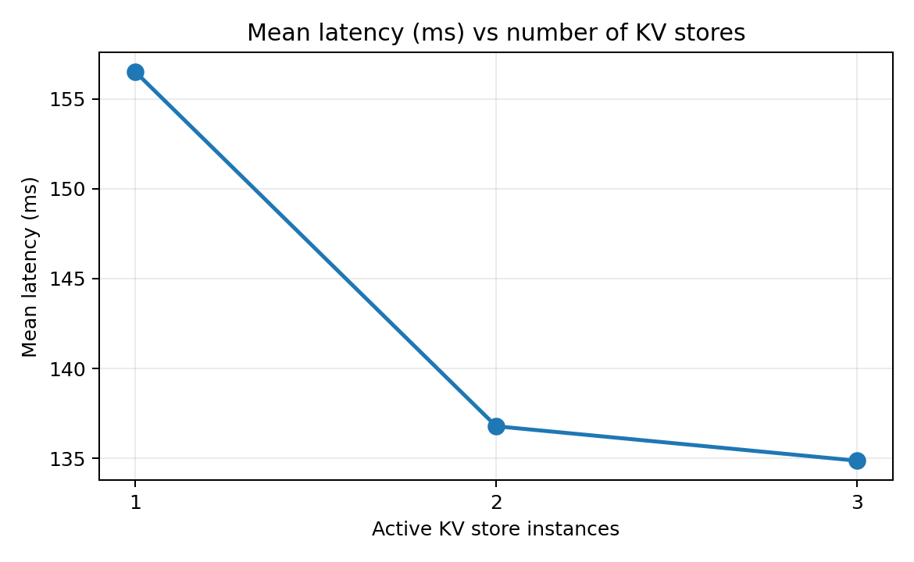
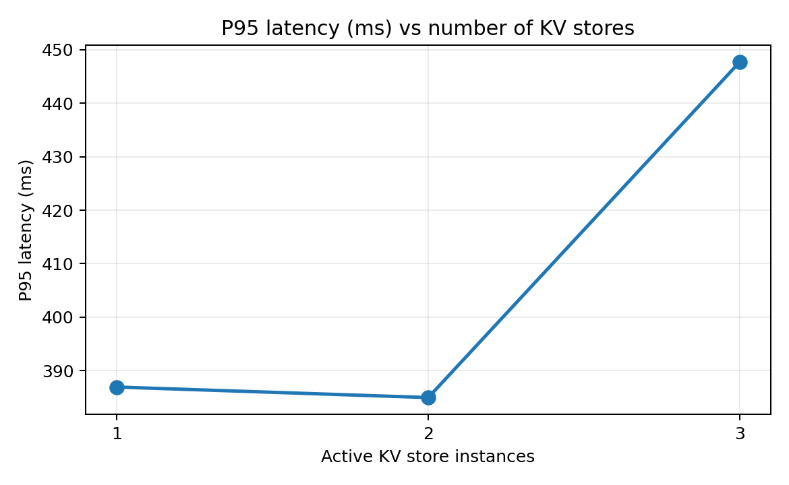

# Homework 3 — Distributed KV Store: Setup and Verification

## Overview

The assignment extends a Flask/SQLite key-value service into a partitioned system with one router and up to three active backend stores. Keys are assigned by a SHA-256 consistent-hash ring using 128 virtual nodes per store. Each backend has a separate persistent Docker volume.

## Start the deployment

```powershell
docker compose up -d --build
docker compose ps
Invoke-RestMethod -Uri "http://localhost:8000/health" -TimeoutSec 300 | ConvertTo-Json -Depth 10
python -m pip install -r requirements-dev.txt
```

The router is available at `http://localhost:8000`; backend services use port 8080 only inside Docker. The `/health` endpoint reports the active membership and virtual-node count.

## CRUD and membership commands

```powershell
Invoke-RestMethod -Uri "http://localhost:8000/demo_key" -Method Put -ContentType "application/json" -Body '{"value":"first"}' -TimeoutSec 300
Invoke-RestMethod -Uri "http://localhost:8000/demo_key" -Method Get -TimeoutSec 300
Invoke-RestMethod -Uri "http://localhost:8000/demo_key" -Method Delete -TimeoutSec 300
Invoke-RestMethod -Uri "http://localhost:8000/_admin/membership" -Method Post -Headers @{"X-Admin-Token"="local-dev-token"} -ContentType "application/json" -Body '{"nodes":["kv1","kv2","kv3"]}' -TimeoutSec 300
Invoke-RestMethod -Uri "http://localhost:8000/_admin/distribution" -Headers @{"X-Admin-Token"="local-dev-token"} -TimeoutSec 300
```

The `local-dev-token` value is a local test credential, not a production secret. The membership endpoint accepts unique subsets of `kv1`, `kv2`, and `kv3`.

## Test results

```powershell
python -m pytest -q test_hash_ring.py
python -m pytest -q test_integration_hw3.py
python -m pytest -v -s test_router_lock.py test_concurrency.py
```

Recorded outcomes:

| Check | Result |
|---|---|
| Hash ring unit tests | 3 passed in 0.14 s |
| Integration test | 1 passed in 598.50 s |
| Router locking and concurrency tests | 2 passed in 4.74 s |
| Concurrent request exercise | 60 PUTs and 30 DELETEs on one key completed successfully |

The first concurrency test attempt failed during collection because the client targeted port 8080 rather than the router's port 8000. After correcting the endpoint and rerunning, both tests passed. The integration test took nearly ten minutes in total; a 300-second timeout applies to each HTTP request, not the entire test process.

## Distribution and data integrity

| Active stores | kv1 | kv2 | kv3 | Total |
|---|---:|---:|---:|---:|
| 3 | 986 | 962 | 1,052 | 3,000 |
| 2 | 1,527 | 1,473 | — | 3,000 |
| 1 | 3,000 | — | — | 3,000 |
| 3 (restored) | 986 | 962 | 1,052 | 3,000 |

All 3,000 distinct keys were inserted and retrieved with their expected values before reconfiguration (3,000 correct, zero errors). The five sampled keys (1, 500, 1,000, 2,000, and 3,000) were also retrieved successfully after each scale-down and after restoring three stores. Physical counts stayed at 3,000 throughout the recorded membership transitions; a complete 3,000-key readback was not recorded after every transition.

The membership API reported 1,052 copied keys for 3→2, 1,473 for 2→1, and 2,014 for 1→3. These are the router's `moved` values, not independently timed migration-throughput measurements.

## Benchmark

```powershell
python benchmark_hw3.py --operations 1200 --workers 16 --repeats 3
python plot_hw3.py
```

The benchmark uses 80% GET and 20% PUT by default, 128-byte values, 16 workers, and three repeats per configuration. It seeds keys before timing and removes them afterward. The measurements therefore describe timed requests through the router, excluding seeding, cleanup, and membership migration. The summary is the arithmetic average of three run-level metrics; the P95 column is an average of run-level P95 values, not a pooled percentile.

| Active stores | Throughput (ops/s) | Mean latency (ms) | Mean P95 latency (ms) | Successful / attempted | Errors |
|---|---:|---:|---:|---:|---:|
| 1 | 101.65 | 156.50 | 436.77 | 3,600 / 3,600 | 0 |
| 2 | 116.06 | 136.78 | 276.66 | 3,600 / 3,600 | 0 |
| 3 | 117.84 | 134.87 | 266.51 | 3,600 / 3,600 | 0 |


The mean throughput improved from **101.65** to **117.84** successful operations per second with three active stores. The gain was **15.9%**; mean latency and run-level P95 latency also decreased. This is a single-host measurement with three repeats per configuration, not a claim of linear scalability.

### Performance plots







## Submission evidence

- `HW3_Complete_PowerShell_History.txt`: Docker startup, CRUD, test output, 3,000-key verification, membership transitions, and benchmark output.
- `results/benchmark.csv`: all nine measured runs.
- `results/throughput.png`, `results/latency_mean.png`, `results/latency_p95.png`: plots generated from the CSV.
- `REPORT_HW3.md`: implementation, detailed results, and limitations.

## Troubleshooting and constraints

- Connection refused at port 8080 when testing the distributed router: use port **8000** for distributed tests. The concurrency test initially used the wrong port and passed after correction.
- A slow integration test is not necessarily a timeout: the recorded integration run passed in 598.50 seconds. HTTP requests are configured for 300 seconds **per request**.
- Reconfiguration scans and migrates keys synchronously; avoid changing membership while running a benchmark.
- The design partitions keys but does not replicate them or provide automatic recovery when a backend fails.
- Do not delete named Docker volumes if stored keys must remain available.
