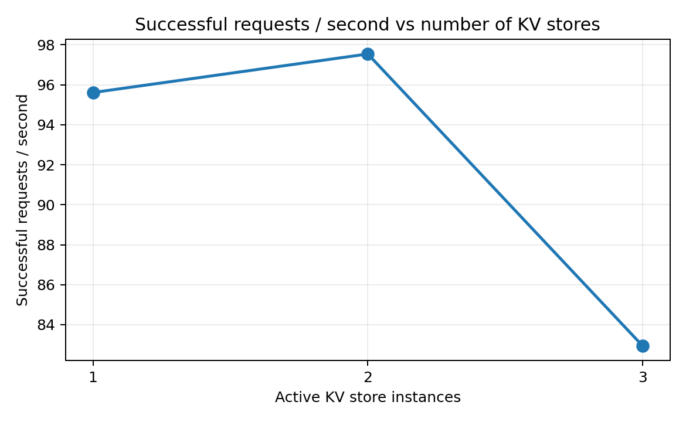
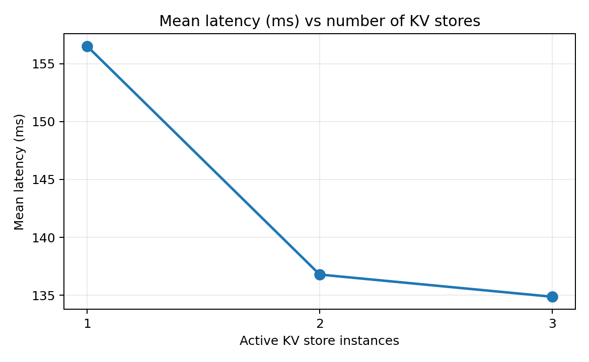
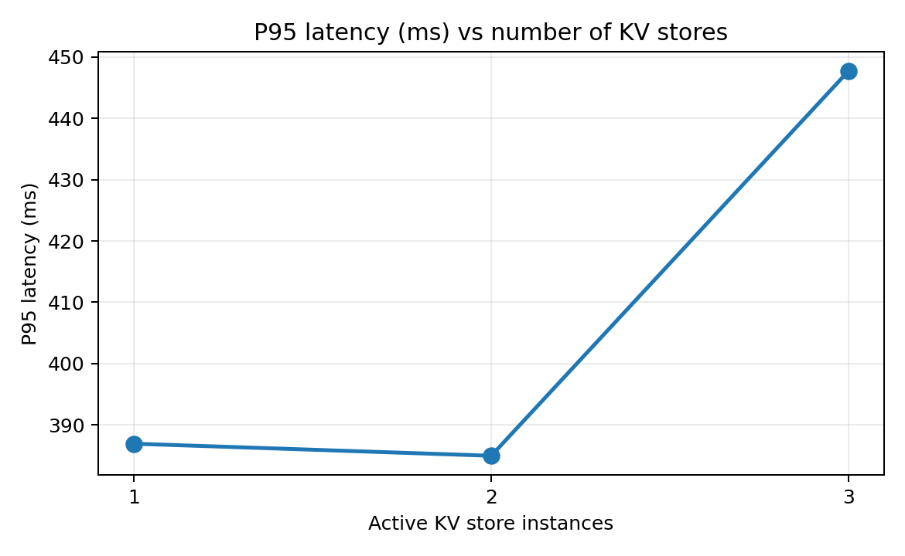

# Assignment 3 Report — Distributed Key-Value Store with Consistent Hashing

## 1. Objective

Extend the existing Dockerized Flask/SQLite key-value service to support one, two, and three active stores using consistent hashing. Evaluate data placement, preservation during membership changes, concurrent operation, throughput, and request latency.

## 2. Implementation

The deployment consists of one Flask router and three Flask/SQLite backend containers (`kv1`, `kv2`, `kv3`). Requests enter through port 8000 and are forwarded over a private Docker network to backend services listening on port 8080. Each backend uses its own named volume, making the stores independent partitions rather than replicas.

The hash ring uses SHA-256 and 128 virtual nodes per physical store. A key belongs to the first virtual node clockwise from its hash, with wraparound. This produces deterministic routing and reduces redistribution compared with remapping every key on membership changes.

The router uses a writer-preferring reader/writer lock. Ordinary requests hold shared read access during forwarding and can overlap; membership updates acquire exclusive access. During reconfiguration, the router inventories keys, copies data to new owners, switches the active ring, and removes stale copies. The procedure is synchronous and temporarily blocks ordinary requests.

## 3. Test environment and procedure

The recorded tests ran using Windows PowerShell 5.1, Python 3.11.9, Docker 29.9.2, Docker Compose 5.6.1, and Docker Desktop with an engine reporting 4 CPUs and 4,037,599,232 bytes of memory. The containers share this host's compute resources, so the measurements represent a small single-machine deployment rather than independent physical servers.

The deployment was built with `docker compose up -d --build`. The recorded execution included CRUD operations, unit and integration tests, concurrency checks, insertion and verification of 3,000 keys, membership changes, and a nine-run benchmark. The full terminal evidence is in `HW3_Complete_PowerShell_History.txt`.

## 4. Functional and concurrency verification

```powershell
python -m pytest -q test_hash_ring.py
python -m pytest -q test_integration_hw3.py
python -m pytest -v -s test_router_lock.py test_concurrency.py
```

Recorded outcomes:

| Check | Result |
|---|---|
| Hash ring unit tests | 3 passed in 0.14 s |
| Integration test | 1 passed in 598.50 s |
| Router locking and concurrency tests | 2 passed in 4.74 s |
| Concurrent request exercise | 60 PUTs and 30 DELETEs on one key completed successfully |

The first concurrency test attempt failed during collection because the client targeted port 8080 rather than the router's port 8000. After correcting the endpoint and rerunning, both tests passed. The integration test took nearly ten minutes in total; a 300-second timeout applies to each HTTP request, not the entire test process.

The CRUD exercise also confirmed create, read, update, delete, and HTTP 404 after deletion. The successful concurrency exercise demonstrates simultaneous client operations without observed failures in that test; it does not by itself establish linear throughput scaling.

## 5. Key placement and membership changes

The insertion test completed 3,000 PUTs with zero errors, followed by 3,000 correct GETs with zero errors. The distribution endpoint reported the following physical key counts:

| Active stores | kv1 | kv2 | kv3 | Total |
|---|---:|---:|---:|---:|
| 3 | 986 | 962 | 1,052 | 3,000 |
| 2 | 1,527 | 1,473 | — | 3,000 |
| 1 | 3,000 | — | — | 3,000 |
| 3 (restored) | 986 | 962 | 1,052 | 3,000 |

All 3,000 distinct keys were inserted and retrieved with their expected values before reconfiguration (3,000 correct, zero errors). The five sampled keys (1, 500, 1,000, 2,000, and 3,000) were also retrieved successfully after each scale-down and after restoring three stores. Physical counts stayed at 3,000 throughout the recorded membership transitions; a complete 3,000-key readback was not recorded after every transition.

The membership API reported 1,052 copied keys for 3→2, 1,473 for 2→1, and 2,014 for 1→3. These are the router's `moved` values, not independently timed migration-throughput measurements.

For three stores, the ideal count is 1,000 keys per store. The maximum absolute deviation was 52 keys (5.2% of ideal), supporting reasonably balanced placement for this key set. The physical total remained 3,000 during the recorded membership sequence, and the five sampled keys remained readable after each transition. This is not equivalent to a full readback of every key after each transition.

## 6. Benchmark methodology

```powershell
python benchmark_hw3.py --operations 1200 --workers 16 --repeats 3
python plot_hw3.py
```

The benchmark uses 80% GET and 20% PUT by default, 128-byte values, 16 workers, and three repeats per configuration. It seeds keys before timing and removes them afterward. The measurements therefore describe timed requests through the router, excluding seeding, cleanup, and membership migration. The summary is the arithmetic average of three run-level metrics; the P95 column is an average of run-level P95 values, not a pooled percentile.

The benchmark measures successful requests per second and individual request latencies. It uses one, two, and three active stores while all three containers remain running. It excludes container startup and migration from the timed section. Each configuration has 3 × 1,200 = 3,600 timed operations, for 10,800 operations overall.

## 7. Performance results

| Active stores | Throughput (ops/s) | Mean latency (ms) | Mean P95 latency (ms) | Successful / attempted | Errors |
|---|---:|---:|---:|---:|---:|
| 1 | 101.65 | 156.50 | 436.77 | 3,600 / 3,600 | 0 |
| 2 | 116.06 | 136.78 | 276.66 | 3,600 / 3,600 | 0 |
| 3 | 117.84 | 134.87 | 266.51 | 3,600 / 3,600 | 0 |


### Individual benchmark runs

| Stores | Repeat | Throughput (ops/s) | Mean (ms) | P50 (ms) | P95 (ms) | P99 (ms) | Errors |
|---|---:|---:|---:|---:|---:|---:|---:|
| 1 | 1 | 96.726 | 164.407 | 122.041 | 486.245 | 896.397 | 0 |
| 1 | 2 | 104.383 | 152.267 | 115.688 | 412.018 | 745.861 | 0 |
| 1 | 3 | 103.855 | 152.828 | 118.715 | 412.051 | 800.257 | 0 |
| 2 | 1 | 114.866 | 138.232 | 114.466 | 291.943 | 542.648 | 0 |
| 2 | 2 | 114.694 | 138.275 | 120.476 | 261.189 | 486.453 | 0 |
| 2 | 3 | 118.610 | 133.843 | 112.621 | 276.849 | 551.969 | 0 |
| 3 | 1 | 116.572 | 136.355 | 112.394 | 300.791 | 583.192 | 0 |
| 3 | 2 | 115.438 | 137.567 | 111.997 | 250.292 | 1014.844 | 0 |
| 3 | 3 | 121.524 | 130.679 | 113.208 | 248.442 | 462.960 | 0 |


### Interpretation

- **Throughput:** one to two stores increased throughput by **14.2%**; one to three increased it by **15.9%**.
- **Mean latency:** decreased from **156.50 ms** to **134.87 ms**, a **13.8%** reduction.
- **P95 latency:** the average of the per-run P95 values decreased from **436.77 ms** to **266.51 ms**, a **39.0%** reduction.
- **Reliability:** all nine repetitions reported 1,200 successful requests and zero errors each.

The greatest throughput gain occurred between one and two stores. The increase from two to three was only **1.5%**, which is small relative to run-to-run variation. Results demonstrate improved throughput and latency in this measured workload, but not linear scaling or a statistically established advantage of three stores over two.

### Figures







## 8. Challenges and design tradeoffs

The concurrency tests initially failed during pytest collection because the test client connected to port 8080 while the router was published on port 8000. After correcting the target endpoint, the lock and concurrency tests passed. The integration test passed but took 598.50 seconds, illustrating that synchronous migrations can be expensive even when individual HTTP timeouts are 300 seconds.

The reader/writer lock permits ordinary requests to overlap while maintaining exclusive membership changes. It improves the opportunity for backend parallelism, but the shared router, per-request HTTP forwarding, SQLite write contention, and shared Docker resources remain potential bottlenecks. The benchmark results alone cannot isolate the exact contribution of each component.

## 9. Limitations and future improvements

- Data is partitioned, not replicated; failure of an active backend can make its keys unavailable.
- The system has one router, no consensus, no automatic failover, and no cross-router membership synchronization.
- Membership migration is synchronous and uses per-key HTTP operations, which can become costly for large datasets.
- The local benchmark uses only three repetitions per configuration and 16 workers; additional workload sizes, concurrency levels, and hosts would improve the evaluation.
- The router admin token is a local development default and should be replaced for any exposed deployment.

## 10. Reproducibility

```powershell
docker compose up -d --build
python -m pip install -r requirements-dev.txt
python -m pytest -q test_hash_ring.py
python -m pytest -q test_integration_hw3.py
python -m pytest -v -s test_router_lock.py test_concurrency.py
python benchmark_hw3.py --operations 1200 --workers 16 --repeats 3
python plot_hw3.py
```

The commands above require the router to be running on port 8000. Running the benchmark again overwrites `results/benchmark.csv`; preserve earlier measurements before rerunning. The recorded evidence, CSV, and figures are included with the project.

## 11. Conclusion

The implementation successfully partitions keys using consistent hashing, redistributes keys across membership changes, and processes concurrent requests. The recorded benchmark shows a **15.9%** increase in throughput and lower average and P95 latency when moving from one to three active stores, with no benchmark request errors. The gains are sublinear and limited by the single-host architecture, but the results support the assignment's objective of demonstrating a functioning, scalable partitioned key-value service.
